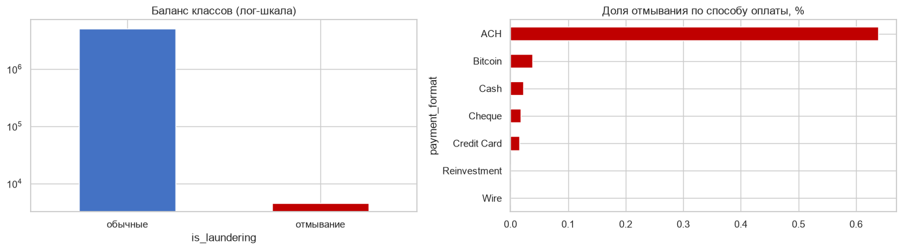
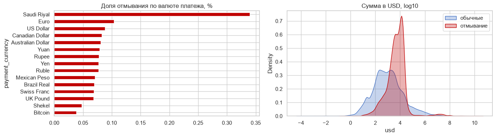
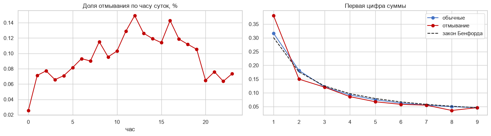
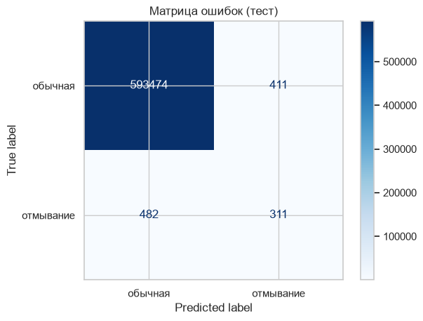
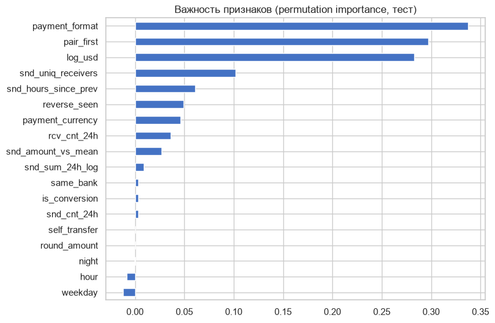

# Результаты AMLGuard

## Данные

5 077 228 операций за 1–10 сентября 2022, 4 522 случая отмывания (0,09%). Хвост 11–18 сентября исключён как артефакт генератора (около 1 100 операций, около 60% отмывания).

Отмывание сосредоточено в переводах ACH: около 0,64% таких операций — отмывание, в разы больше, чем у любого другого способа. Поэтому правило, построенное на интуиции «подозрительны наличные и биткоин», работает плохо.

## Модели на тесте

Тест — последние 15% операций по времени: 594 678 операций, 793 случая отмывания.

| Модель | PR-AUC | Recall@1% | Precision | Recall | F1 | ROC-AUC |
|---|---|---|---|---|---|---|
| Правило-baseline | 0,0024 | 0,021 | 0,0024 | 0,612 | 0,005 | 0,713 |
| Логистическая регрессия | 0,0320 | 0,260 | 0,041 | 0,701 | 0,077 | 0,966 |
| Бустинг (по умолчанию) | 0,3489 | 0,738 | 0,388 | 0,376 | 0,382 | 0,985 |
| **Бустинг (подобран)** | **0,3847** | **0,752** | **0,431** | **0,392** | **0,411** | **0,985** |

Подбор гиперпараметров поднял PR-AUC бустинга с 0,349 до 0,385 и precision с 0,39 до 0,43.

При пороге по максимуму F1 модель нашла 311 из 793 случаев отмывания при 411 ложных тревогах на 593 885 обычных операций: около 720 операций на проверку вместо почти 600 тысяч.

## Важность признаков

Главные факторы: способ оплаты, первый перевод этой паре счетов (деньги уходят новым получателям), сумма в USD, число уникальных получателей у отправителя (веерные рассылки). Час и день недели дали слабое отрицательное влияние: за 10 дней их связь с отмыванием неустойчива, в следующей версии их стоит убрать.
